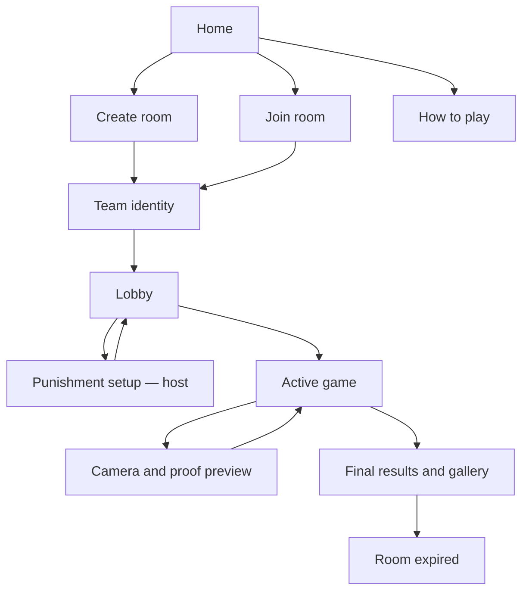

# touch grass — Product & Technical Architecture

**Status:** Hackathon MVP specification, 15 November 2026  
**App name:** touch grass
**Goal:** Ship a native, multiplayer mobile game that can be demonstrated on real phones today.

## 1. Product thesis

Middle- and high-school friend groups often meet at malls and spend their time wandering around without a shared activity. touch grass turns that hangout into a two-hour, real-world team competition. Friends split into teams, complete three challenging activities, capture proof, and reunite to learn the results and see the memories they made.

The value proposition is **something to do together, a reason to explore, and funny stories to bring back**. The product should minimize time spent navigating the phone.

The main target is existing friend groups, not strangers. A team normally consists of two people sharing one phone; one person may also participate on that phone without any separate solo mode or extra setup.

### Market context

- [PicChase](https://picchase.app/) demonstrates that room-code photo hunts, custom challenges, galleries and account-free play already exist.
- [Goosechase](https://www.goosechase.com/) offers real-world photo/video missions, primarily in organized experiences.
- [RollCall](https://www.rollcallapp.social/) combines friend-group challenges, photo proof and punishments.
- [Dareloop](https://apps.apple.com/us/app/dareloop-dare-your-friends/id6743373035) offers dares and video proof.

The proposed differentiation is a deliberately spontaneous, teen-oriented hangout game: no organizer expertise, a short fixed game setup, balanced distinct challenges, a final punishment reveal and a shared memory gallery. These competitors establish that the category exists; they do not establish product-market fit. Test actual willingness to start and replay the game with 3–5 friend groups before expanding the feature set.

### Product risks and remedies

| Risk | MVP response |
|---|---|
| Too much setup before friends can play | Room code, one phone per team, one team name/photo, one punishment screen |
| Uneven challenges feel unfair | Exactly one easy, medium and hard challenge per team; no duplicate challenges in a room |
| Poor connectivity while walking around | Persist membership locally, reactive reconnect, retain unsent captures locally and allow retry |
| Cheating or unconvincing evidence | In-app capture only, one piece of submitted evidence per challenge; no AI or voting yet |
| A team finishes and everyone loses interest | Keep remaining teams playing; reveal winner, last place and gallery only at the end |
| Punishments become harmful or coercive | Optional, consensual, safe punishments only; players may decline to carry out any punishment |
| Private media involving minors is exposed | Private invite-only rooms, time-limited media access, no public feed or public sharing, automatic deletion |

## 2. Explicit scope

### Included

- Home: Create room, Join room, How to play.
- No account registration or individual profiles.
- A room code, host, lobby, team name and one optional team profile photo (initials fallback if image fails or is unavailable).
- One phone per team; typically two friends, technically one person is allowed. No individual-member management.
- Host selects a supplied preset punishment, enters a custom safe punishment, or skips. One page.
- Minimum two teams before start; no new teams after start.
- Fixed two-hour game by default. Server-controlled countdown and start time.
- Each team receives three different challenges, one per difficulty tier, with no challenge duplicated across the room.
- Each challenge is completed using an in-app photo or video (60 seconds maximum).
- In-app capture preview, Submit, Retake, and Save as Blooper (local camera roll only).
- Live team leaderboard showing completion count and team identity; no evidence shown before results.
- Third successful submission automatically completes the team. No Done button.
- Reveal only after every team finishes or the two-hour deadline occurs.
- Winner is first to finish all three; if nobody completes all three, highest completion count wins. Determine last place for the selected optional punishment.
- Results page with final standings and room-only photo/video gallery. All room members can save every submitted item to their own device.
- Room becomes inaccessible and data expires 30 minutes after the scheduled game deadline.
- Automatic reconnection on the same device after closing/reopening the app.
- Advanced button and explanatory placeholder; no functional advanced settings.

### Deferred

Reverse auction, together mode, individual-mode toggle, custom duration, environment selection/filtering, custom challenge sets, custom point weights, alternate judgment systems, AI verification, votes/disputes, live evidence/individual challenge visibility, late joining, optional one-challenge reroll, chat, accounts, friends list, public sharing, payments, location tracking and push notifications.

The advanced placeholder may list these relevant options as **Coming later**. It must not imply that they currently work. The reroll is not part of default play. If implemented later, a reroll should be limited to one per team and replace an incomplete challenge with an unused challenge of the same difficulty.

## 3. Technology and deployment

| Layer | Choice |
|---|---|
| Mobile | Expo, React Native, TypeScript |
| Routing | Expo Router or simple typed stack; use one consistently |
| Realtime backend | Convex managed database, queries, mutations, scheduled functions |
| Media | Convex File Storage |
| Capture | expo-camera (photo and video) |
| Playback | expo-video; images with React Native Image |
| Local persistence | expo-secure-store for randomly generated team session token; AsyncStorage or local file system for non-sensitive pending media metadata |
| Device saving | Expo MediaLibrary and Expo FileSystem |
| Development | Capy, Git repository, conventional Expo scripts |
| QA | Capy cloud phones powered by Revyl, plus at least two physical devices when available |

Do not add a custom API server, socket server, SQL database, separate accounts or a location service. Convex is the authority for room state, membership, time, assignments, submissions and results. React Native renders state and accesses device functionality.

Use dependencies installed via `npx expo install` where applicable, chosen to match the Expo SDK version actually installed. Do not hardcode an unverified latest SDK version. Keep configuration in `.env.local` with `EXPO_PUBLIC_CONVEX_URL`; commit a sample env file and never commit secrets.

### External references

- [Convex React Native quickstart](https://docs.convex.dev/quickstart/react-native)
- [Convex realtime architecture](https://docs.convex.dev/realtime)
- [Convex file uploads](https://docs.convex.dev/file-storage/upload-files)
- [Expo Camera](https://docs.expo.dev/versions/latest/sdk/camera/)
- [Expo Video](https://docs.expo.dev/versions/latest/sdk/video/)
- [Capy cloud phone documentation](https://docs.capy.ai/cloud-phones)

## 4. Main screen flow



Keep each screen minimal. Use a consistent white or neutral background, readable black text, one accent color, generous touch targets and clear primary actions. The UI should be easy to restyle later. No heavy animation, branding assets or custom design system required.

### Home

Title touch grass and three large actions: Create room; Join room; How to play. If a saved session is still valid, automatically resume it rather than making the user rejoin (allow explicit return to home after expiration). How to play is a short static text screen: teams, three challenges, evidence, two hours, ranking, gallery and optional punishment.

### Create / Join

Create: enter team name, optionally capture profile picture, then create the room and become host. Join: enter a room code, validate it, enter team name and optionally capture profile picture, then join. Normalize room codes (uppercase, trim whitespace). Display understandable errors for missing names, nonexistent codes, full rooms or games already started. Avoid duplicate taps creating additional teams.

### Lobby and punishment

Show code prominently with Copy and team list. Host sees Start Game (disabled below two teams). Other teams see Waiting for host. Host selects preset, custom or skip on one screen; default skip is valid. All participants can see selected punishment before start. Include a simple reminder that participation in punishment is optional. Host can choose Advanced, which opens a nonfunctional preview of planned options. All participants get the active game screen immediately on start via query update. No host-only controls after start.

### Active game

- Header: countdown (HH:MM:SS), room/team context.
- Three challenge cards, in easy/medium/hard order, with text, difficulty and state (not started, uploading, completed).
- Each incomplete challenge has Capture proof. Completed card is marked with a check and cannot be submitted again.
- Live leaderboard: team name/photo and completed count such as 2/3. Display sorted progress but do not display winner/loser labels or reveal evidence during play.
- When third submission is accepted, show a simple finished/waiting screen or banner: `All challenges complete! Waiting for the other teams.` Continue showing countdown and live leaderboard.
- Countdown reaching zero moves everyone to results once the backend finalizes. A network error must not silently award completion.

### Camera and proof preview

Request camera/microphone permission when first needed. Support Photo and Video controls, switching camera if feasible, record/stop, elapsed recording time, auto-stop at 60 seconds. Use a reasonably small resolution/quality so uploads work on mobile data. Preview image or video. Options:

1. **Submit:** upload the media, finalize challenge submission on the backend, and mark complete only on confirmation.
2. **Retake:** discard the unsent capture and return to camera.
3. **Save as Blooper:** request photo-library permission, save the capture to the local camera roll, then return to capture/active challenge; never upload it or mark completion.

No media library picker for challenge evidence. Cancel returns to game and does not complete anything. Allow upload retry while the game is active. Capture may be saved locally for retry if connectivity is lost. A submitted challenge cannot be edited or replaced in MVP.

### Results/gallery

Display winner, final standings, last place and selected punishment if any. Show ties explicitly rather than arbitrarily assigning a punishment to an indistinguishable last-place team. Show all submitted photos and videos with team and challenge labels, a full-screen viewer, and Save to Camera Roll per item. If feasible, add Save All with visible progress, sequential downloads and proper permission/error handling; per-item saving is the required MVP. Never include bloopers in this gallery. Do not expose images publicly or generate a public link. Display time until room/media expiration.

## 5. Data model (Convex)

Use `defineSchema`, typed IDs and indexes. Names below are canonical but minor implementation differences are fine if behavior is preserved.

| Table | Fields and purpose | Indexes |
|---|---|---|
| `rooms` | `code`, `status` (`lobby`, `active`, `results`, `expired`), `hostTeamId`, `createdAt`, optional `startedAt`, `endsAt`, `resultsAt`, `expiresAt`, `punishmentKind` (`skip`, `preset`, `custom`), optional `punishmentText`, optional `winnerTeamId`, optional `loserTeamId` | `by_code`, `by_status` |
| `teams` | `roomId`, `name`, optional `avatarStorageId`, `sessionToken` (random secret, never returned to other teams), `joinedAt`, optional `finishedAt`, `completedCount` | `by_room`, `by_session_token` |
| `challenges` | `key`, `description`, `difficulty` (`easy`, `medium`, `hard`), `category`, `environments` array, optional `enabled` | `by_key`, `by_difficulty` |
| `punishments` | `key`, `description`, optional `category`, optional `enabled` | `by_key` |
| `assignments` | `roomId`, `teamId`, `challengeId`, `difficulty`, `descriptionSnapshot`, `assignedAt`, `state` (`pending`, `completed`), optional `completedAt`, optional `submissionId` | `by_room`, `by_team`, `by_team_challenge` |
| `submissions` | `roomId`, `teamId`, `assignmentId`, `storageId`, `mediaType` (`photo`, `video`), `mimeType`, optional `durationSeconds`, `submittedAt` | `by_room`, `by_team`, `by_assignment` |

Use a short random uppercase code, e.g. six alphanumeric characters with confusing characters omitted. Check for collision in the mutation before creating a room. A room code can locate a lobby and allow joining; it is **not** a credential for reading active room data or gallery media. Generate a high-entropy random token on the device using a secure RNG, store it in SecureStore, and associate it with the team server-side. Every state-changing or private-room query validates the token and room membership. A token is a passwordless session secret, not a user account. Backend responses never disclose other teams' tokens. Host privilege is derived from the token's resolved team ID and the room host ID, never from a client-supplied `isHost` flag.

### Content import contract

The founders will provide real challenge and punishment lists. Do not invent the production database. Make JSON files easy to replace and add an idempotent seed command/mutation with validation, duplicate-key checks, tier counts and a clear report. A small set of clearly labeled safe development-only placeholders may be used to verify multiplayer flow until supplied content arrives; do not mix these into the final production bundle by accident.

`data/challenges.json` format:

```json
[
  {
    "key": "challenge_001",
    "description": "Founder-supplied challenge text",
    "difficulty": "easy",
    "category": "creative",
    "environments": ["mall", "downtown", "anywhere"],
    "enabled": true
  }
]
```

`data/punishments.json` format:

```json
[
  {
    "key": "punishment_001",
    "description": "Founder-supplied punishment text",
    "category": "funny",
    "enabled": true
  }
]
```

The environment/category metadata is retained but not used to filter missions in the MVP. Provide a short README with the import process. Avoid requiring precise location data. Validate that every game can be assigned its required number in each difficulty tier, and reject starting with a helpful error if content is insufficient.

## 6. Backend state and rules

### State machine

| State | Allowed operations | Transition |
|---|---|---|
| lobby | Join, read lobby, host selects punishment, host starts | `startGame` → active |
| active | Read own assignments/leaderboard, generate proof upload URL, submit evidence, reconnect | All teams complete or deadline → results |
| results | Read standings/gallery, download media, reconnect | Scheduled expiration → expired |
| expired | No private reads or writes; return expiration message | Cleanup removes room content |

### Starting a game

The host starts in one authoritative mutation. Recheck status and host identity. Require at least two teams. Read enabled challenge pools by difficulty; verify each has at least the number of teams. Randomly shuffle each tier server-side, allocate without replacement so every team gets exactly one of each, create assignment snapshots, set `startedAt = now`, `endsAt = now + 2h`, `expiresAt = endsAt + 30m`, and mark room active. Schedule an internal deadline function and an expiration/cleanup function using the Convex scheduler. All writes should be part of one successful mutation; an unsuccessful start leaves the room in the lobby with no assignments.

### Submission

1. Client requests a file upload URL for an active room, valid session, own pending assignment, and before deadline.
2. Client uploads photo/video to URL; collect returned storage ID.
3. Client calls `submitEvidence` with token, assignment ID, storage ID, media type, MIME, duration if video.
4. Mutation revalidates membership, ownership, pending status, room active, `now < endsAt`, storage metadata/type/size where supported, and duration <= 60 seconds as supplied by the controlled camera client. Reject unsupported types and invalid IDs. Do not claim server-side media-duration verification if not implemented.
5. Persist submission, mark assignment completed, increment team's count, set `completedAt` using server time. On the third completion, set the team `finishedAt` using server time. Never accept a second proof for the same assignment. Make retries safe/idempotent for an already-submitted same storage ID; a conflicting duplicate is rejected.
6. If all room teams now have count 3, finalize results atomically. Otherwise game remains active.

Keep track of abandoned uploaded media or implement a cleanup strategy; at minimum remove attached room media at expiration and delete any known unattached uploads during error cleanup. Do not give the mobile client blanket read/list access to storage. Limit size and use supported photo/video types; use a practical max (e.g. 50 MB per video) and a clear retry/retake error if exceeded. No externally hosted media URLs from users.

### Ranking and ending

Rank by completed count descending (0–3). Among teams with all three, earliest server `finishedAt` wins. For equal incomplete counts, prefer the earliest server completion time of their last completed challenge as a provisional tie-break (not a point weighting system). If neither has completed any tasks or timestamps are indistinguishable, mark a tie; do not invent a loser. Determine winner/last place only once, at finalization. Return final standings from the stored room result plus immutable team/assignment data. If all teams complete early, reveal results immediately then; otherwise reveal at the deadline. Do not end the game just because one team finishes. Keep media accessible until `endsAt + 30 minutes` even if everyone finishes early, fulfilling the scheduled retention window.

Use a backend scheduled function to finalize deadline independently of open clients. A public read should never return active content as editable after the deadline. All mutations independently check server time. The timer UI calculates remaining time from backend deadline, ticks locally once/sec, and resynchronizes on reconnect; no per-second database writes. Schedule expiration even if nobody is online.

On expiration, prevent further access first, then delete submitted media, avatars, assignments and teams/room records or retain only a minimal anonymous expired-code tombstone if needed to display an expired message. Never rely on a per-device countdown to delete media. Cleanup is idempotent and should retry safely. Warn users that room proof will be deleted after the window; downloaded copies remain on their individual devices.

### Suggested public API

These names are illustrative; preserve responsibilities.

- `rooms.createRoom({name, sessionToken, avatarStorageId?})`: create room and host team, return roomCode/teamId.
- `rooms.joinRoom({code, name, sessionToken, avatarStorageId?})`: lobby only, create team or safely return existing same-session membership.
- `rooms.lookupLobby({code})`: only minimal joinability status; no private media or member secrets.
- `rooms.getSession({sessionToken})`: validate and return current user's room/team state or expired/invalid.
- `rooms.getLobby({sessionToken})`: lobby public-to-members team display fields.
- `rooms.setPunishment({sessionToken, kind, presetKey?, customText?})`: host and lobby only.
- `rooms.startGame({sessionToken})`: authoritative start and assignment.
- `game.getMyAssignments({sessionToken})`: only own assignments, no other team's evidence.
- `game.getLeaderboard({sessionToken})`: live count and safe team display data.
- `game.generateProofUploadUrl({sessionToken, assignmentId})`: authorize pending submission.
- `game.submitEvidence({...})`: validate and complete one assignment transactionally.
- `gallery.getResults({sessionToken})`: only results phase, returns ranking and authorized media URLs. Do not return proof URLs while active.
- Internal functions `finalizeAtDeadline(roomId)`, `expireRoom(roomId)`, and cleanup helpers.

Use generated Convex types and file-storage APIs, not guessed endpoints. Profile upload URL issuance can be a minimal pre-join endpoint with limits and cleanup, or grant after team membership and update its avatar. Do not make optional avatar capture block room creation; initials fallback is acceptable.

## 7. Client session and errors

Persist token (and optionally last room code) on device after joining. At launch, validate session with backend; route by room state. If active, rehydrate server timer, challenge state and leaderboard. If results, route directly to gallery. If expired, show expiration and clear local token. On transient offline error, preserve token and retry; do not treat network failure as invalid membership.

Disable duplicate submit/start/join controls during pending requests. Provide explicit loading, permission denied, upload progress/busy, retry and not-connected states. The server resolves conflicts independently. No optimistic awarding of points or finished status. Do not show network logs, tokens or internal errors to players.

## 8. Recommended file layout

```text
app/
  _layout.tsx
  index.tsx
  create.tsx
  join.tsx
  how-to-play.tsx
  lobby.tsx
  punishment.tsx
  advanced.tsx
  game.tsx
  capture.tsx
  results.tsx
  expired.tsx
components/
  Button.tsx
  TeamAvatar.tsx
  ChallengeCard.tsx
  Countdown.tsx
  Leaderboard.tsx
  ProofPreview.tsx
  GalleryItem.tsx
lib/
  session.ts
  media.ts
  time.ts
  ranking.ts
  config.ts
convex/
  schema.ts
  rooms.ts
  game.ts
  gallery.ts
  content.ts
  lifecycle.ts
  auth.ts
data/
  challenges.json
  punishments.json
tests/
README.md
.env.example
```

## 9. Verification checklist

Run TypeScript checking and lint before demo. Test data validation, assignment uniqueness, ranking, room deadline, duplicate submission, authorization and reconnection. Use short, test-only games in a development deployment to exercise expiration without waiting two hours; production duration must remain 2h. Keep the test override out of the normal UX and disabled in production.

Capy/Revyl test scenario: attach two cloud phones if plan/slots allow; build and install the app; create room on A; attempt start with one team (disabled); join on B; start; verify same deadline and distinct easy/medium/hard challenges; complete proof(s); verify live count; attempt late join and unauthorized actions; force close/reopen; verify state resumes; complete both teams or expire a short test room; verify final rank, private gallery and expiry. Cloud camera simulation may not behave exactly like a real device, so test actual camera, microphone, capture, camera roll save and upload on real phones before demo. If Revyl is unavailable, continue using Expo and physical devices, not a different architecture.

## 10. Demo and validation

Demo the complete journey on two devices: one hosts, one joins, both receive different challenges, capture and submit real evidence, watch the live leaderboard update, finish, and reveal the winner, punishment and gallery. Prepare a short-duration test room solely for the demo if time is constrained, or complete all three challenges on both phones to trigger the normal early results transition.

After hackathon, measure: time from opening to room started; percent of rooms starting with two or more teams; percentage of teams completing at least one/all three challenges; percentage of media successfully submitted; gallery saves; and whether the group voluntarily initiates another game. Do not claim PMF from a successful demo alone.

## 11. Privacy and release boundary

This is a hackathon prototype intended for private friend groups. Keep media and room data limited to invited participants and avoid recording uninvolved people without permission. Do not require location, contact list, real names or dates of birth. Use safe, consent-based challenge and punishment content, prohibit trespassing, harassment, dangerous dares and nonconsensual recording, and never publish someone's proof or force them to carry out a punishment. A public release to children requires an age/privacy/compliance review, content safeguards and a considered retention policy; do not present this prototype as ready for unrestricted under-13 use.
